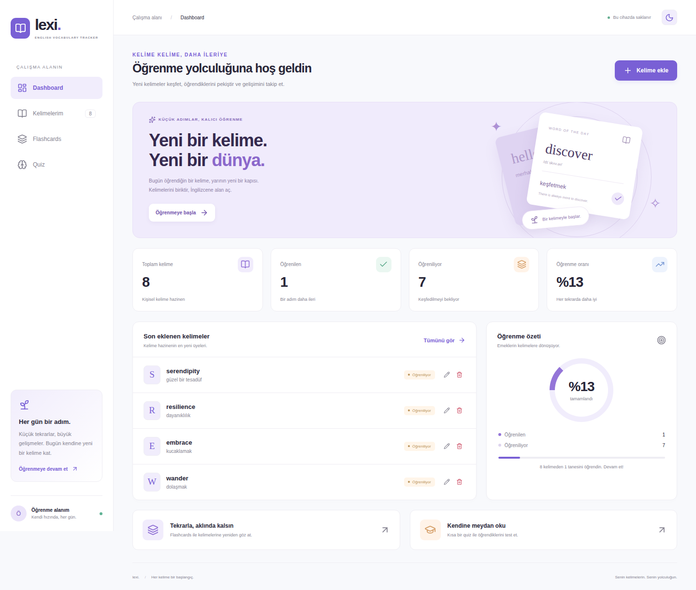
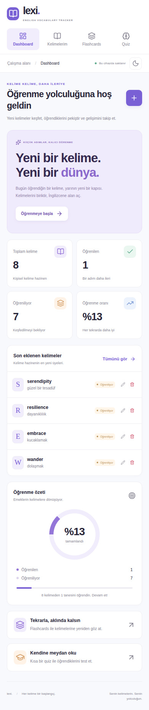

# Lexi · English Vocabulary Tracker

İngilizce kelimeleri Türkçe karşılıklarıyla kaydetmek, tekrar etmek ve öğrenme durumunu takip etmek için geliştirilmiş React uygulaması. Yapay Zeka Destekli Web Geliştirme eğitiminin final çalışmasıdır.

**[Canlı uygulamayı aç](https://english-vocabulary-tracker-ten.vercel.app)** · **[GitHub kaynak kodları](https://github.com/ahmetemresanli/english-vocabulary-tracker)**

## Projenin amacı

Lexi, İngilizce kelime öğrenimini kolaylaştırmak için dağınık kelime notlarını kişisel bir çalışma alanında birleştirir. Kullanıcıların kelimeleri Türkçe karşılıklarıyla kaydetmesini, tekrar kartları (flashcard) ile çalışmasını, kısa testler (quiz) çözmesini ve öğrenme ilerlemesini takip etmesini sağlar. Üyelik, sunucu uygulaması, ücretli API veya API anahtarı gerektirmez.

## Özellikler

- Kelime, Türkçe karşılık ve isteğe bağlı İngilizce örnek cümle ekleme, düzenleme ve onayla silme.
- Boş ve yinelenen kelime kontrolü; öğrenildi / öğreniliyor durumları.
- İngilizce ve Türkçe arama, durum filtresi, alfabetik ve eklenme tarihine göre sıralama.
- Canlı istatistikler, öğrenme oranı, ilerleme grafiği ve son eklenenler.
- Çevrilebilir flashcards, ileri / geri gezinme, karıştırma ve öğrenme durumu değiştirme.
- En fazla 10 soruluk quiz, dört farklı seçenek, anlık yanıt kontrolü ve sonuç özeti.
- LocalStorage kalıcılığı, bozuk kayıt kontrolü ve yazma hatası bildirimi.
- Açık / koyu tema, farklı ekran boyutlarına uyumlu tasarım, klavye erişimi ve odak yönetimli modal formlar.
- Kullanıcının seçimiyle eklenen, açıkça demo olarak belirtilen 8 örnek kelime.

## Teknolojiler

- **React 19:** Bileşen tabanlı kullanıcı arayüzü ve durum yönetimi.
- **Vite 8:** Yerel geliştirme sunucusu ve üretim derlemesi.
- **JavaScript / JSX ve CSS:** Uygulama mantığı, arayüz, tema ve farklı ekran boyutlarına uyumlu tasarım.
- **Lucide React:** Arayüz simgeleri.
- **LocalStorage:** Kelimelerin ve tema tercihinin tarayıcıda saklanması.
- **ESLint:** Statik kod kontrolü.
- **Node.js test çalıştırıcısı:** Veri ve quiz mantığı için otomatik testler.
- **Playwright / Chromium:** İsteğe bağlı kurulumla çalıştırılan tarayıcı testleri.
- **Vercel:** Canlı uygulamanın yayımlanması.

## Kurulum

Node.js 22.12+ (veya Vite 8 ile uyumlu daha yeni bir sürüm) ve npm gerekir.

```bash
git clone https://github.com/ahmetemresanli/english-vocabulary-tracker.git
cd english-vocabulary-tracker
npm ci
npm run dev
```

Terminalde gösterilen yerel adresi açın. Ortam değişkeni veya API anahtarı gerekmez. Üretim önizlemesi için önce `npm run build`, ardından `npm run preview` çalıştırın. Diğer komutlar:

```bash
npm run build    # dist/ klasöründe üretim derlemesi oluşturur
npm run preview  # Derlenen uygulamayı yerelde önizler
npm run lint     # Statik kod kontrolü yapar
npm test         # Veri ve quiz mantığı testlerini çalıştırır
```

## Proje yapısı

```text
src/
  components/   # Modal, WordForm, WordList
  hooks/        # LocalStorage kayıt yönetimi
  pages/        # Flashcards ve Quiz
  styles/       # Tema, temel ve responsive stiller
  utils/        # Doğrulama, quiz ve demo verileri
  App.jsx       # Navigasyon, dashboard ve uygulama işlemleri
  main.jsx      # React başlangıcı
public/         # Uygulama simgesi
tests/          # Veri doğrulama ve quiz testleri
docs/screenshots/ # Uygulama ekran görüntüleri
```

## Kullanım

1. **Kelime ekle** ile İngilizce kelime ve Türkçe karşılığını girin. Dilerseniz örnek cümle ekleyin.
2. **Kelimelerim** bölümünde arayın, filtreleyin, sıralayın veya kalem simgesiyle düzenleyin. Durum etiketine basarak kelimeyi öğrenildi olarak işaretleyin.
3. **Flashcards** bölümünde karta basarak çevirin, oklarla gezinin veya karıştırın.
4. **Quiz** için en az dört farklı Türkçe karşılığa sahip kelime ekleyin. Bir seçenek seçin ve sonraki soruya geçin.
5. Üstteki ay simgesiyle temayı değiştirin. **Kelimelerim → Tüm verileri sıfırla** işlemi onayınızla bütün kelimeleri kaldırır.

Veriler `evt.words.v1`, tema tercihi `evt.theme` anahtarında saklanır. Her kelime `id`, `english`, `turkish`, `exampleSentence`, `learned`, `createdAt`, `updatedAt` alanlarını taşır. Geçersiz JSON uygulamayı çökertmez; okunamayan veriler açılışta otomatik olarak üzerine yazılmaz. Yeni bir kayıt işlemi geçerli listeyi kaydeder. Depolama yazılamazsa mevcut liste korunur ve hata gösterilir.

## Ekran görüntüleri

Ekran görüntülerinde örnek/demo kelimeler kullanılır.





## Yapay zeka kullanım açıklaması

Bu proje, Yapay Zeka Destekli Web Geliştirme eğitiminin final çalışması kapsamında **OpenAI Codex** yardımıyla geliştirilmiştir. Codex; uygulamanın planlanması, React bileşenlerinin ve CSS tasarımının oluşturulması, veri doğrulama ve LocalStorage mantığının geliştirilmesi, testlerin yazılması, hata ayıklama ve dokümantasyon aşamalarında kullanılmıştır. Yapay zeka destekli geliştirme, proje gereksinimleri doğrultusunda dosyalar üzerinde doğrudan uygulanmış; build, lint ve otomatik kontrollerle doğrulanmıştır.

Codex'in kullanıldığı başlıca süreçler:

- **Planlama:** Gereksinimlerin özelliklere, sayfalara ve geliştirme adımlarına ayrılması.
- **React bileşenleri:** Kelime formu, liste, modal, dashboard, flashcards ve quiz akışlarının bileşenler halinde geliştirilmesi.
- **Arayüz tasarımı ve stil düzenlemeleri:** CSS stilleri, açık/koyu tema ve farklı ekran genişliklerine uygun responsive düzenlerin hazırlanması ve iyileştirilmesi.
- **Test:** Veri ve quiz mantığına yönelik otomatik testlerin hazırlanması, tarayıcı test akışının oluşturulması ve lint/build/test çıktılarının değerlendirilmesi.
- **Hata ayıklama:** Veri doğrulama, LocalStorage ve kullanıcı etkileşimlerindeki sorunların incelenmesi; düzeltmelerin lint, build ve testlerle kontrol edilmesi.

**ChatGPT**, bu teslim sürecinde proje gereksinimlerinin, README içeriğinin ve yapay zeka kullanım açıklamasının konuşma üzerinden netleştirilmesinde kullanılmıştır. Planlama, bileşen geliştirme, arayüz tasarımı, test ve hata ayıklamaya yönelik dosya işlemleri mevcut proje açıklamasında Codex'e atfedilir; ChatGPT'nin aynı geliştirme işlemlerini ayrıca gerçekleştirdiğine ilişkin doğrulanmış bir kayıt bulunmadığından böyle bir katkı iddia edilmez.

Yapay zeka araçları geliştirme ve dokümantasyon sürecinde yardımcı olarak kullanılmıştır. Çalışan uygulamada OpenAI API çağrısı veya yapay zeka servisi bulunmaz. Test sonuçları aşağıda tarih ve kapsamlarıyla belirtilmiştir.

## Proje bağlantıları ve yayın

- **GitHub deposu:** [ahmetemresanli/english-vocabulary-tracker](https://github.com/ahmetemresanli/english-vocabulary-tracker)
- **Canlı uygulama:** [Lexi — Vercel](https://english-vocabulary-tracker-ten.vercel.app)

Projenin geliştirme, test ve yayın aşamaları tamamlanmıştır. Uygulama Vercel üzerinde statik site olarak sunulur. Yayın yapılandırması:

| Ayar | Değer |
| --- | --- |
| Proje kökü | Depo kök dizini |
| Çatı seçimi | Vite |
| Bağımlılık kurulumu | `npm ci` |
| Derleme komutu | `npm run build` |
| Çıktı klasörü | `dist` |
| Ortam değişkenleri | Gerekmiyor |

Navigasyon uygulama içi durum yönetimi kullandığından sunucu tarafında yönlendirme kuralı gerektirmez. Yerel geliştirme adresindeki tarayıcı verileri farklı bir origin kullanan canlı uygulamaya otomatik taşınmaz.

Depoda alternatif statik yayın için `netlify.toml` yapılandırması da bulunur. `node_modules/`, `dist/`, hassas `.env` dosyaları ve `.vercel/` Git dışında tutulur. `package.json` içindeki `private: true`, npm üzerinde yanlışlıkla paket yayını yapılmasını engeller; GitHub deposunun görünürlüğünü belirlemez.

## Sınırlılıklar

- Veriler yalnızca kullanılan tarayıcı ve origin üzerinde kalır; cihazlar arasında senkronize edilmez. Tarayıcı verilerini temizlemek kayıtları siler.
- LocalStorage erişimi veya kotası tarayıcı tarafından kısıtlanabilir. Çok sekmeli eşzamanlı düzenleme desteklenmez.
- Çeviri doğruluğu kullanıcıya aittir; otomatik sözlük veya telaffuz servisi yoktur.
- Quiz sonuçları oturumluk gösterilir; geçmiş sonuçlar saklanmaz. Öğrenme yüzdesi kullanıcının işaretlediği durumlardan hesaplanır.

## Gelecek geliştirmeler

İleride değerlendirilebilecek, mevcut sürümde bulunmayan özellikler: JSON içe/dışa aktarma, aralıklı tekrar, kelime kategorileri, quiz geçmişi ve çevrimdışı PWA desteği.

## Testler ve çalıştırılan kontroller

15 Kasım 2026 teslim hazırlığında aşağıdaki komutlar yeniden çalıştırıldı:

| Komut | Kapsam | Sonuç |
| --- | --- | --- |
| `npm run lint` | ESLint ile statik kod kontrolü | Başarılı, hata yok |
| `npm run build` | Vite üretim derlemesi | Başarılı, `dist/` üretildi |
| `npm test` | `tests/vocabulary.test.js`: kayıt kimlikleri ve zaman damgaları, bozuk/geçersiz JSON, yinelenen kayıtlar, düzenleme/durum/silme serileştirmesi, normalleştirme, quiz seçenekleri ve karıştırma | Başarılı, başarısız test yok |

`tests/browser-check.mjs` mevcut Playwright/Chromium fonksiyonel testidir. Kelime işlemleri, LocalStorage, flashcards, quiz, tema ve farklı ekran boyutlarındaki görünümü kontrol eder. Önceki çalıştırmanın sonuçları 14 Kasım 2026 tarihli test raporunda kayıtlıdır; bu teslim hazırlığında tarayıcı testi yeniden çalıştırılmadı. Ekran görüntüleri mevcut rapora ait demo görselleridir.

Çalıştırılan kontroller, kapsam ve test edilmeyen senaryolar için [test raporuna](docs/TESTING.md) bakın. Tekrar çalıştırılabilir tarayıcı testi `tests/browser-check.mjs` içindedir; isteğe bağlı Playwright kurulumu test raporunda açıklanır.
